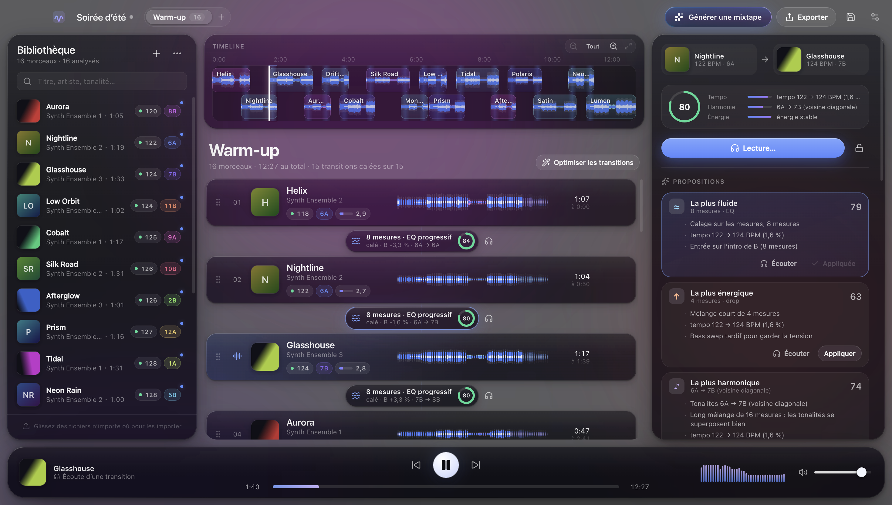
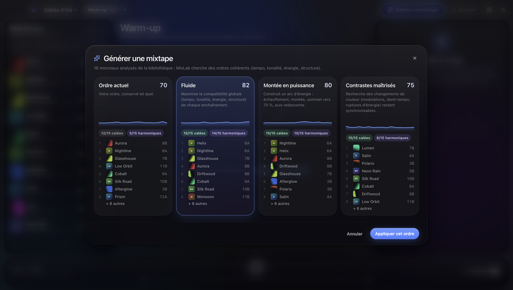
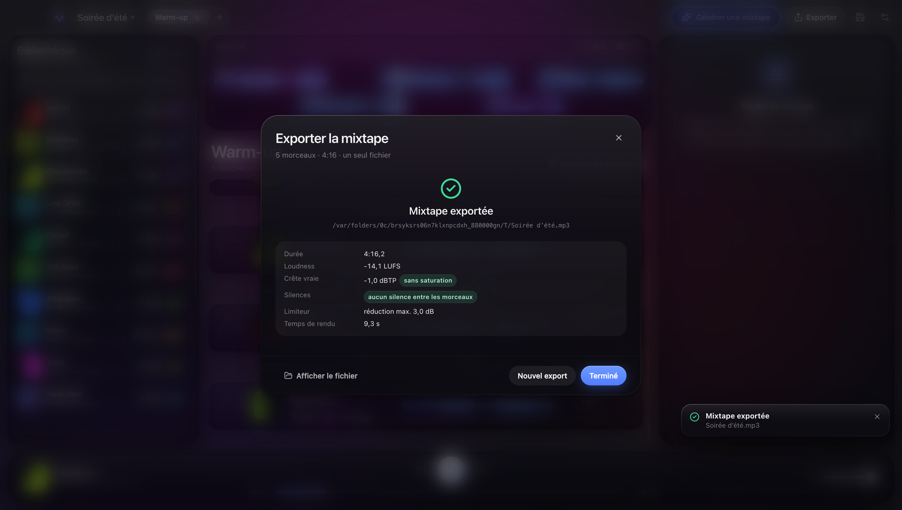
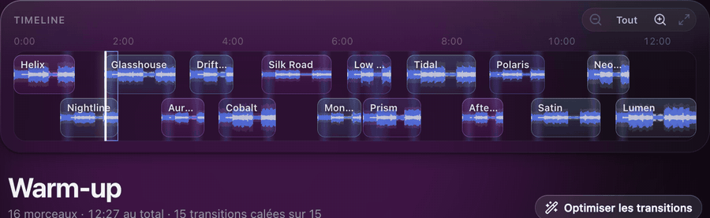

<p align="center"><strong>English</strong> · <a href="README.fr.md">Français</a></p>

# MixLab

[](https://github.com/ja2a/mixlab/actions/workflows/ci.yml)
[](https://github.com/ja2a/mixlab/releases/latest)
[](LICENSE)


**Automatic mixtapes from your own music files.** Drop in your MP3s: MixLab analyses them (tempo, beats, bars, key,
loudness, structure), suggests the best track order and transitions, lets you listen to every blend, and exports the
whole mix as **one continuous MP3** (or WAV) — beat-matched, level-matched, no gaps, no clipping.

Everything runs on your computer. No file is ever uploaded, and your original files are only read, never modified.



| Generate a mixtape | One-file export |
|---|---|
|  |  |



## Download

Ready-to-install builds are on the [Releases](https://github.com/ja2a/mixlab/releases) page:

| System | File |
|---|---|
| Mac with Apple Silicon (M1, M2…) | `MixLab-x.y.z-arm64.dmg` |
| Mac with Intel | `MixLab-x.y.z.dmg` |
| Windows 10/11 (64-bit) | `MixLab-Setup-x.y.z.exe` |

FFmpeg is bundled with the installers from version 0.1.3 on — nothing else to install.

**First launch on macOS:** MixLab is not signed with an Apple certificate. Open it once, then go to **System Settings →
Privacy & Security** and click **Open Anyway**. On Windows, SmartScreen may show "Windows protected your PC": click
**More info → Run anyway**.

## Features

- **Analysis** — BPM with confidence (half/double-time aware), beat grid and downbeats, musical key (Camelot), loudness
  (LUFS, BS.1770-4) and true peak, leading/trailing silence, structure (intro, verse, chorus, drop, break, outro),
  energy. BPM, key and beat grid can be corrected by hand.
- **Suggestions** — a compatibility score combining tempo, harmony, energy, structure and vocal overlap; four explained
  transition proposals per pair (smoothest, most energetic, most harmonic, surprising); several global orders computed
  by optimisation, with locked tracks and transitions respected. Your manual order is always kept.
- **Energy shape and length** — ask for a mixtape that rises, peaks, holds a plateau, comes in waves or winds down, and
  optionally for a target length (30 min to 2 h): MixLab then picks which tracks to use, not only their order.
- **Mixing engine** — transitions aligned on bars; the incoming track is time-stretched (WSOLA, pitch preserved) to
  match, then eased back to its own tempo; progressive 3-band EQ with bass swap; per-track loudness normalisation and a
  true-peak limiter. Five transition types: crossfade, custom curves, beat-synced, progressive EQ, structure-based.
- **DJ effects** — on any transition: filter sweep (the incoming track opens from a low-pass while the outgoing one is
  high-passed away), tempo-synced echo out, or loop roll (last beat repeated, then ½ and ¼ beat).
- **Key change** — transpose a track by up to ±3 semitones without changing its tempo; MixLab suggests the shift that
  makes two keys blend.
- **Long intros and outros** — a quiet intro or outro longer than 16 bars (adjustable, or off) is cut on a downbeat
  where a transition happens; the first track keeps its intro and the last one its outro. Manual cue points always win.
- **Studio** — choose length, curves, swap point, exit/entry points, gains; set cue in/out on the waveform; audition and
  compare proposals.
- **Preview = export** — the preview streams from the very engine used for export; output is bit-identical whatever the
  block size.
- **Export** — MP3 192/256/320 kb/s or 24-bit WAV, ID3 metadata and chapters, optional `.cue` sheet, rendered in the
  background with progress and clean cancellation.
- **Projects** — several mixtapes per project; moved or renamed files are found again by content fingerprint.

## Build from source

Requirements: Node.js ≥ 22 and FFmpeg (macOS: `brew install node ffmpeg`, Windows: `winget install OpenJS.NodeJS FFmpeg`).

```bash
npm install
npm start          # build and run
npm run dev        # development mode with hot reload
npm run dist:dir   # unpacked app in release/
```

To embed FFmpeg the way release builds do, run `npm run ffmpeg:fetch` first: it downloads pinned, SHA-256-verified
static builds into `vendor/ffmpeg/`, which electron-builder copies into `Resources/bin`.

Official installers are built by GitHub Actions: push a `vX.Y.Z` tag (with the same version in `package.json`) and a
draft release is created with the macOS and Windows installers. Running the Release workflow manually does a dry run.

## Tests

```bash
npm test          # 69 Vitest tests: analysis, mixing, effects, export, suggestions, projects, 25-file acceptance run
npm run test:e2e  # 9 Playwright scenarios on the real Electron app
```

Test audio is synthesised by `src/core/testing/synth.ts` (known tempo, key and structure) — no commercial music is
included. The tests check, among others: exported duration = sum of tracks − overlaps (< 50 ms), no silence between
tracks, true peak under the ceiling, beats of the incoming track landing on the outgoing track's grid (< 12 ms on
rendered audio), LUFS matching FFmpeg's `ebur128`, and a responsive UI during export.

## Architecture

```
src/core/       pure TypeScript engine (analysis, music logic, mix plan, WSOLA, EQ, limiter, export, projects)
src/main/       Electron main process + worker threads (analysis pool, preview, export)
src/preload/    typed IPC bridge (context isolation, sandbox)
src/renderer/   React UI — "Liquid Glass" design system (see DESIGN.md)
```

The full technical documentation (algorithms, design choices, acceptance criteria) is in the
[French README](README.fr.md).

## Known limitations

- 4/4 time only; tempo assumed constant (tracks with drifting tempo are not beat-matched — the app says so).
- Key detection can confuse relative major/minor; confidence is shown and the key can be corrected.
- Structure, energy and vocal presence are heuristic estimates.
- Time-stretching stays clean up to about ±4 %; beyond that artefacts are possible and flagged.
- Validated on synthetic material; behaviour on large real-world libraries still needs field testing.
- The Windows installer is built automatically but has not yet been tried on a real PC.

## License

MIT — see [LICENSE](LICENSE). The installers bundle FFmpeg (GPL on macOS, LGPL on Windows): see
[THIRD_PARTY_NOTICES.md](THIRD_PARTY_NOTICES.md).
